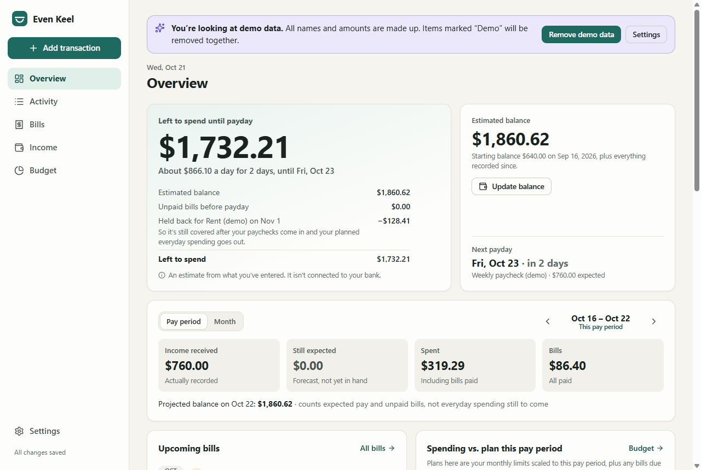

# Even Keel

A calm, simple budgeting app for one person who gets paid weekly (or every two weeks, twice a month, or monthly) and wants quick answers to:

- **How much money do I have?** An estimated balance, kept up to date from what you record.
- **What bills are coming up, and when?** Upcoming and overdue bills, ticked off as you pay them.
- **How much can I spend until my next payday?** "Left to spend" after the bills due before payday.
- **Where has my money gone?** Spending by category against your plan, top places, and a 6-month trend.

It's a Windows desktop app. All data stays on the computer. There's no bank connection, no account, and nothing is sent anywhere. The only network request it makes is to check GitHub for app updates.



---

## For the person using it

### Install

1. Open the project's **Releases** page on GitHub and download the latest `EvenKeel-Setup-x.y.z.exe`.
2. Run it. Windows may show "Windows protected your PC" because the installer isn't code-signed. Click **More info → Run anyway**.
3. Even Keel installs for your user account (no admin password) and opens. A desktop shortcut is added.

### Updating

When a new version is published, the app notices on startup (and every few hours while open) and shows a banner:

> **A new version is available.** → **Update now** → **Restart and update**

You can also check any time in **Settings → App updates → Check for updates**. Updating never touches your data.

### Getting started

The Overview page walks you through four steps: your current balance, your paycheck, your regular bills, and a first expense. You can also click **Explore with demo data first** to look around with made-up numbers. Demo items are labelled "Demo" and removed with one click.

Handy to know:

- Press **N** anywhere (or the **+** button) to add a transaction. Amount → category → Enter.
- **Tick a bill** when you pay it. It becomes an expense, and next month's bill stays on the schedule.
- **Record pay** when a paycheck lands. Until then it shows as *expected*, which is a forecast, not money you have.
- If the balance drifts from your bank, use **Update balance** and type what the bank says.

### Your data

- Saved automatically to `%APPDATA%\Even Keel\even-keel-data.json`. **Settings → Your data** shows the exact path.
- A backup copy is kept for each of the last 14 days in the `backups` folder next to it.
- **Settings** can export transactions to CSV (opens in Excel), back up everything to a file, and restore from a backup.
- Updating or uninstalling the app does not delete your data.
- The data lives on this one computer only. To move to a new PC, back up there and restore here.

### What the numbers mean

| Term | Meaning |
|---|---|
| **Estimated balance** | Your starting balance plus everything recorded since. Not read from your bank. |
| **Left to spend until payday** | Balance minus unpaid bills (and overdue ones) due before your next payday. The app also looks six weeks ahead. If a later bill, like rent, wouldn't be covered by the paychecks before it plus your planned everyday spending (your category limits), the shortfall is held back now, and the app says which bill. |
| **Received vs. expected income** | Received = paychecks you recorded. Expected = paydays that haven't happened or haven't been recorded yet. |
| **Spent** | Every expense recorded, including bill payments. |
| **Planned / monthly limit** | What you intend to spend per category each month. It's a plan, not money. In the pay-period view, limits are scaled to the length of the period, with bills counted in the period they're due. |
| **Projected balance** | Balance plus expected pay minus unpaid bills by a date. It doesn't include everyday spending you haven't entered yet. |

---

## For the maintainer

### Tech

- **Electron 45** (desktop shell, file storage, auto-update via `electron-updater` + GitHub Releases)
- **React 19 + TypeScript + Vite 8** (UI in `src/`)
- **Vitest** for calculation and data tests, **Playwright** for end-to-end tests against the real Electron app
- Installer: **electron-builder** (NSIS, per-user, no admin)

### Commands

```bash
npm install          # once
npm run dev          # run the app with hot reload
npm run typecheck    # TypeScript
npm test             # unit tests (dates, recurrence, money, budget math, reducer, persistence, CSV)
npm run test:e2e     # builds, then drives the real app through the main flows
npm run qa:screens   # screenshots of every page/theme/size into e2e-artifacts/
npm run dist         # all checks + build the installer into release/ (no upload)
```

`npm run dev:web` runs just the UI in a browser. It stores data in localStorage, so it's useful for quick UI work but not as the real app.

### Shipping an update (this is what your buddy's Update button pulls)

**One-time setup**

1. Create a **public** GitHub repo and push this project to it. Installed apps read releases anonymously, so a private repo won't work unless you publish releases to a separate public repo.
2. Make sure `build.publish` in `package.json` names that repo (`owner` / `repo`). It's currently set to `ForgeLabsAutomation/even-keel`.

**Every release**

```bash
npm version patch          # 1.0.0 -> 1.0.1 (or: minor / major). Commits and tags v1.0.1
git push --follow-tags     # GitHub Actions tests, builds and publishes the release
```

The **Release** workflow (`.github/workflows/release.yml`) runs on Windows:

1. Checks that the tag matches `package.json`.
2. Runs the typecheck, unit tests and end-to-end tests.
3. Builds `EvenKeel-Setup-x.y.z.exe` into a draft release.
4. Checks that the installer, its `.blockmap` and `latest.yml` (what the updater reads) are all attached, then publishes the release.

Installed copies pick it up on their next check (at startup and every few hours). To show "What's new" in the app, edit the release notes on GitHub. If a step fails, nothing is published. Fix the problem, delete the draft release and the tag, then tag again.

Notes:

- Don't change `build.appId` (`com.evenkeel.budget`) after people have installed the app. Windows uses it to recognise updates. `productName` controls the display name and the data folder name, so changing it would also start a fresh data folder.
- The installer is unsigned, so SmartScreen warns on the first install. Updates install silently without the warning. A code-signing certificate (set `CSC_LINK` / `CSC_KEY_PASSWORD` in the workflow) removes it.
- Only Windows is built. macOS auto-update requires a paid Apple signing identity.

### Project layout

```
electron/          main process: window, IPC, crash-safe JSON storage, updater
src/lib/           pure logic: dates, money, recurrence, budget math, CSV, validation (+ tests)
src/state/         data model, reducer, persistence & repair, demo data (+ tests)
src/features/      screens: dashboard, transactions, bills & income, budget, settings
src/ui/            shared components: dialog, fields, menu, toasts, meters
e2e/               Playwright tests that launch the real app
scripts/           dev launcher, icon generator
```

### How the data model avoids double counting

Bills and paychecks are stored as **schedules** (amount, frequency, first date). Individual due dates are computed from the schedule and never stored, so changing the view can't create duplicates. Marking a bill paid or recording a paycheck creates a normal transaction linked to that one date, and each date can be linked to at most one transaction. Unticking removes only that transaction. Editing or pausing the schedule never rewrites past payments. Monthly schedules keep their day of month, falling back to the last day in shorter months (31st → Feb 28 → Mar 31).
